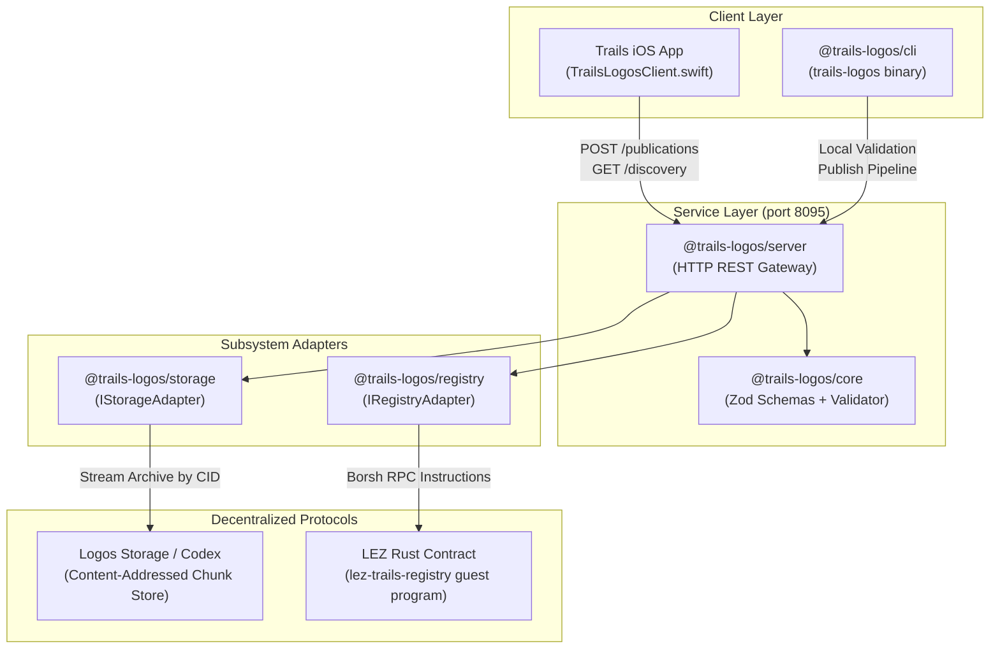
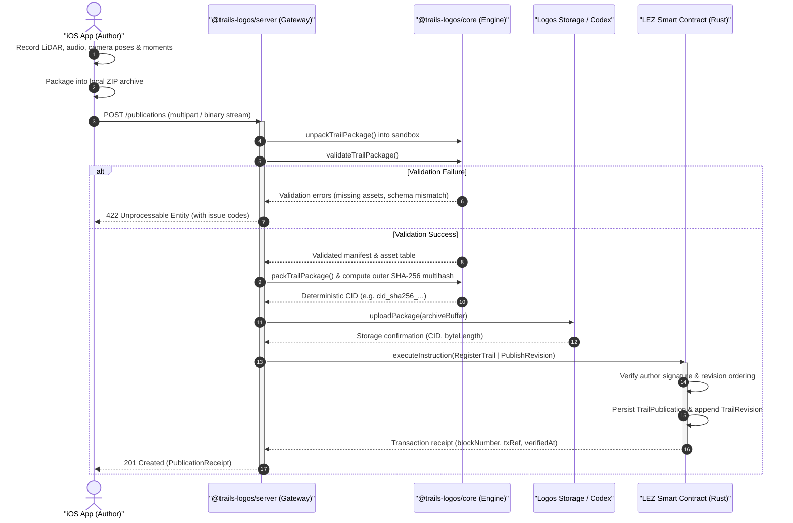
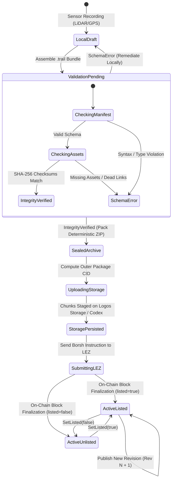
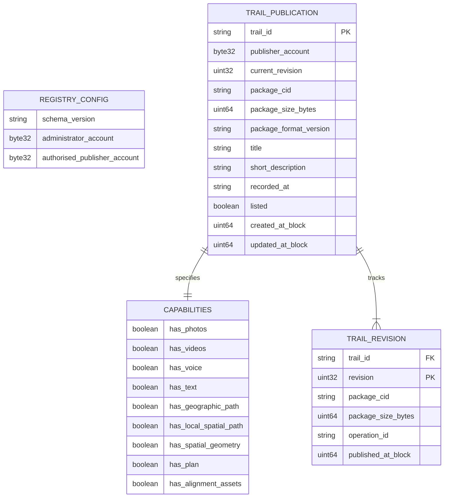
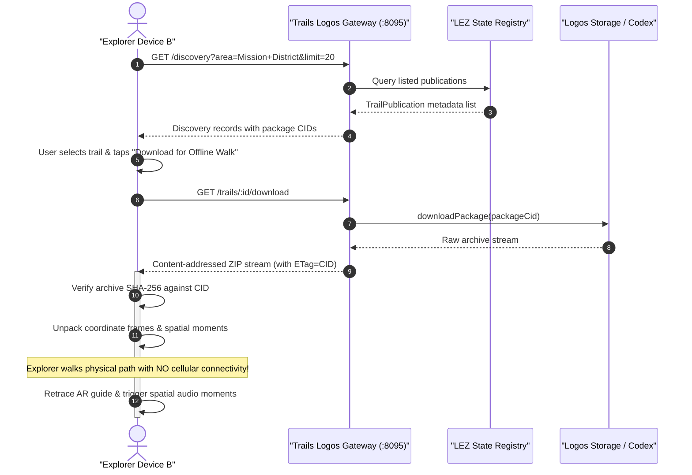

# trails.logos

> Decentralized Spatial Audio & AR Trail Registry & Distributed Asset Storage Layer for **Trails**.

`trails.logos` is the open, peer-to-peer storage and on-chain registry infrastructure backing the Trails spatial capture application. It pairs content-addressed decentralized storage (**Logos Storage / Codex**) with state-machine consensus (**Logos Execution Zone / LEZ**) to provide tamper-proof, censorship-resistant publication, verification, discovery, and offline replay of physical-world spatial walks.

---

## Architecture Overview



---

## Core Design Principles

1. **Deterministic Verification Before Publication**:
   Packages are fully assembled, uncompressed, and validated against canonical schemas before any network transfer. Corrupt assets or missing manifest dependencies are rejected at the edge.
2. **Circular Hash Prevention**:
   The package Content Identifier (CID) is derived from the final sealed outer ZIP archive. The inner `manifest.json` deliberately never stores its own archive CID, maintaining strict acyclic integrity.
3. **Zero-Network Core Validation**:
   `@trails-logos/core` has zero external network or blockchain dependencies. Validation logic can execute anywhere—within the iOS runtime, an edge worker, or a headless build environment.
4. **Dual Runtime Modes (Production & Sandbox)**:
   Every subsystem implements a clean interface (`IStorageAdapter`, `IRegistryAdapter`). The suite transitions between real Logos/LEZ RPC endpoints and local high-fidelity mock implementations without changing application semantics.
5. **Full Offline Replayability**:
   Once downloaded by CID, a trail package is self-contained. The client verifies the SHA-256 integrity, unpacks the coordinate frames, point clouds, audio streams, and textures, and plays back the walk without requiring persistent network access.

---

## End-to-End Publication & Verification Pipeline

The following sequence details how a local spatial recording moves from sensor capture on an iOS device to an immutable, decentralized on-chain publication receipt:



---

## Trail Lifecycle State Machine

A spatial trail moves through strict deterministic states:



---

## On-Chain Data Model & Contract Schema

The Logos Execution Zone (LEZ) contract manages the canonical publication directory using the following relational data structures:



---

## Peer Discovery & Offline Replay Flow

How secondary devices discover and synchronize walks for offline physical execution:



---

## Repository Structure

The project is structured as a pnpm monorepo alongside an official Rust smart contract:

```
trails.logos/
├── core/                   # @trails-logos/core: Schemas, validator, archive utilities
│   ├── src/
│   │   ├── schemas.ts      # Canonical TypeScript types & Zod manifest definitions
│   │   ├── validator.ts    # Comprehensive manifest & package integrity validator
│   │   └── archive.ts      # Deterministic ZIP pack/unpack & SHA-256 CID computation
│   └── package.json
├── storage/                # @trails-logos/storage: Distributed storage adapters
│   ├── src/
│   │   ├── index.ts        # IStorageAdapter interface definition
│   │   └── adapter.ts      # LogosStorageAdapter + MockStorageAdapter
│   └── package.json
├── registry/               # @trails-logos/registry: LEZ on-chain registry adapters
│   ├── src/
│   │   └── index.ts        # IRegistryAdapter, LezRegistryAdapter, MockRegistryAdapter
│   └── package.json
├── server/                 # @trails-logos/server: REST Application API service
│   ├── src/
│   │   ├── server.ts       # HTTP REST server, routes, CORS, validation pipeline
│   │   ├── seed.ts         # Sample discovery fixture generator
│   │   └── bin/server.ts   # CLI service entrypoint (default port 8095)
│   └── package.json
├── cli/                    # @trails-logos/cli: Developer command-line tool
│   ├── src/
│   │   └── bin/cli.ts      # `trails-logos` commander interface
│   └── package.json
├── lez/                    # lez-trails-registry: Logos Execution Zone smart contract
│   ├── Cargo.toml          # Rust package configuration with Borsh support
│   └── src/lib.rs          # State, instructions, and Borsh execution entrypoints
├── scripts/
│   ├── demo.ts             # Reproducible end-to-end acceptance demo
│   └── fixture.ts          # Test fixture factory for compliant packages
├── tests/                  # Integration & unit test suites (Vitest)
│   ├── validator.test.ts   # Manifest schema & structure checks
│   ├── storage.test.ts     # Content addressing and chunk persistence
│   ├── registry.test.ts    # Revision history and publication lifecycle
│   ├── server.test.ts      # REST API route validation
│   └── e2e.test.ts         # Multi-client publish -> discover -> download loop
├── Taskfile.yml            # Cross-platform task runner recipes
├── justfile                # Just command definitions
└── package.json            # Monorepo workspace configuration
```

---

## Package Specification (`manifest.json`)

A valid `.trail` bundle is a ZIP archive containing a root `manifest.json` accompanied by localized media assets:

```json
{
  "manifestVersion": "0.1.0",
  "trailId": "3fa85f64-5717-4562-b3fc-2c963f66afa6",
  "revision": 1,
  "title": "Coyote Hills Ridge & Salt Marsh Trail",
  "shortDescription": "Coastal salt flats and bird migration paths.",
  "recordedAt": "2026-10-29T14:30:00.000Z",
  "author": {
    "displayName": "Hiro",
    "accountAddress": "0x0000000000000000000000000000000000000001"
  },
  "capabilities": {
    "hasPhotos": true,
    "hasVideos": false,
    "hasVoice": true,
    "hasText": true,
    "hasGeographicPath": true,
    "hasLocalSpatialPath": true,
    "hasSpatialGeometry": false,
    "hasPlan": false,
    "hasAlignmentAssets": true
  },
  "coordinateFrames": [
    {
      "id": "frame-0",
      "type": "worldAlignment",
      "datum": "WGS84",
      "origin": { "latitude": 37.552, "longitude": -122.088, "altitudeMeters": 12.4 }
    }
  ],
  "moments": [
    {
      "id": "m1",
      "index": 1,
      "title": "Ridge Vista",
      "timestamp": "2026-10-29T14:31:10.000Z",
      "distanceAlongPathMeters": 42.5,
      "assetReferences": ["audio/moment-1.m4a", "photos/moment-1.jpg"]
    }
  ],
  "assets": [
    {
      "path": "audio/moment-1.m4a",
      "mimeType": "audio/mp4",
      "byteLength": 245120,
      "sha256": "4b227777d4dd1fc61c6f884f48641d02b4d121d3fd328cb08b5531fcacdabf8a"
    },
    {
      "path": "photos/moment-1.jpg",
      "mimeType": "image/jpeg",
      "byteLength": 1048576,
      "sha256": "5c4d32e1...8f0a"
    }
  ],
  "listed": true
}
```

---

## On-Chain Contract (`lez/`)

The on-chain component is implemented in Rust (`lez/src/lib.rs`) compiled to an LEZ guest program:

### State Structures
- **`RegistryConfig`**: Protocol version and administrative authority keys.
- **`TrailPublication`**: Canonical record mapping `trail_id` to `publisher_account`, `current_revision`, `package_cid`, `package_size_bytes`, metadata, and visibility flag (`listed`).
- **`TrailRevision`**: Immutable audit log of every revision published for a given trail ID, binding the `operation_id` to the block number and CID.

### Instructions
- `Initialise`: Bootstrap registry state with authority keys.
- `RegisterTrail`: Submit revision 1 for an unprecedented `trail_id`.
- `PublishRevision`: Append a revision increment for an existing trail. Requires sender signature matching the registered `publisher_account`.
- `SetListed`: Toggle trail visibility in public exploration indexes.

---

## REST API Server Specification

The server runs by default on port `8095` (or configured via `PORT` environment variable).

### Endpoints

| Method | Endpoint | Description |
|---|---|---|
| `GET` | `/health` | Service health status and timestamp. |
| `POST` | `/publications` | Upload raw `.trail` ZIP package for validation, storage, and LEZ registration. |
| `GET` | `/publications/:opId` | Fetch transaction receipt for an ongoing or finalized publication. |
| `GET` | `/discovery` | Query catalog records with filtering (`query`, `area`, `creatorId`, `limit`, `cursor`). |
| `GET` | `/discovery/:id` | Fetch detailed discovery profile for a single trail. |
| `GET` | `/creators` | List and search registered authors and publication portfolios. |
| `GET` | `/trails` | List all registered trail summaries with pagination. |
| `GET` | `/trails/:id` | Get canonical on-chain publication record for a trail ID. |
| `GET` | `/trails/:id/revisions` | List full revision history for a trail. |
| `GET` | `/trails/:id/download` | Stream the raw ZIP package archive by active revision or `?revision=N`. |

---

## Quick Start & Developer Guide

### Prerequisites
- Node.js >= 20.x
- pnpm >= 9.x
- Rust >= 1.75 + Cargo
- `task` or `just` command runner

### Installation & Build

```bash
# Clone and enter the repository
cd trails.logos

# Install dependencies across all workspace packages
pnpm install

# Build all TypeScript packages
pnpm build

# Run unit & integration test suites
task test
# (Runs Vitest across 5 test suites + Cargo test in lez/)
```

### Running the API Gateway Server

```bash
# Start server on http://localhost:8095
task dev

# Or with custom port
PORT=9000 task dev
```

### Executing the Acceptance Demo

The repository includes a standalone, self-verifying end-to-end demonstration (`scripts/demo.ts`):

```bash
task demo
```

The script exercises the complete decentralized lifecycle:
1. Boots mock Logos Storage & LEZ Registry state.
2. Generates a valid multi-asset trail bundle.
3. Performs strict PRD integrity validation.
4. Packs and hashes the deterministic archive.
5. Uploads to storage, computes outer CID, and registers on the LEZ contract.
6. Simulates a second device querying discovery, resolving the package CID, downloading the archive, and unpacking offline.

---

## CLI Reference (`trails-logos`)

The `@trails-logos/cli` package exposes a developer binary for local terminal operations:

```bash
# Inspect available commands
task cli -- --help

# Validate a local directory or ZIP package
task cli -- validate -p /path/to/my-trail

# Publish a trail to local storage & registry
task cli -- publish -p /path/to/my-trail.zip

# Publish targeting live remote endpoints
task cli -- publish -p ./archive.zip --storage logos --registry lez --publisher 0x1234...

# List registered trails
task cli -- list

# Query a specific trail
task cli -- get <trail-id>

# Download a trail archive
task cli -- download <trail-id> -o ./downloaded.zip
```

---

## Integration with Trails iOS Client

The Trails iOS client communicates directly with this service via [`TrailsLogosClient.swift`](file:///N:/hack/trails/ios/Sources/Trails/Services/TrailsLogosClient.swift):

- **Publication Flow**: When a user completes a trail in the iOS app, the app bundles LiDAR mesh, audio notes, and photos, and calls `POST /publications`.
- **Discovery Flow**: The `Explore` and `Community` views query `GET /discovery` and `GET /creators` to fetch peer-created trails without third-party centralized dependencies.
- **Offline Download**: Tapping "Download for Offline Walk" triggers `GET /trails/:id/download`, and stores the package in the local `TrailPackageStore`.

---

## License

MIT OR Apache-2.0
